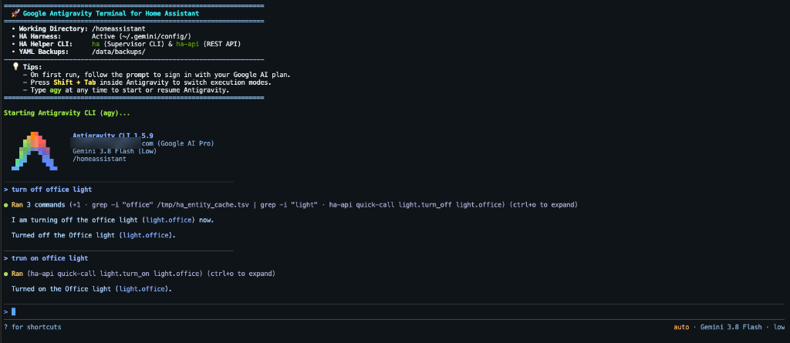
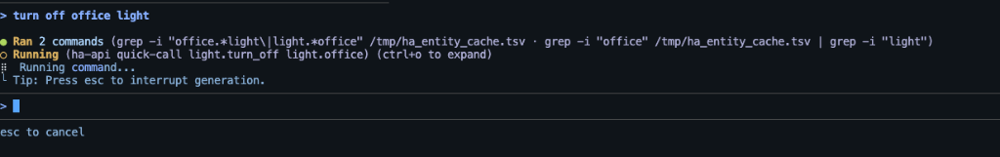

#  Antigravity for Home Assistant (`antigravity-home-assistant`)

[](https://github.com/AssafMiron/antigravity-home-assistant)
[](LICENSE)
[](https://my.home-assistant.io/redirect/supervisor_add_addon_repository/?repository_url=https%3A%2F%2Fgithub.com%2FAssafMiron%2Fantigravity-home-assistant)

Bring **Google Antigravity CLI (`agy`)** directly into your Home Assistant sidebar!

Inspired by [`heytcass/home-assistant-addons`](https://github.com/heytcass/home-assistant-addons) for Claude, this repository provides the **Antigravity Terminal** add-on for Home Assistant, equipped with a built-in **Home Assistant Harness** (Rules, Skills, Fast Prompt Router, Lifecycle Safety Hooks, and Live HA API tools) so Antigravity natively understands your smart home, entities, automations, and Lovelace dashboards.

---

## 📸 Screenshots & Live Demo



*Antigravity running interactively in Home Assistant Ingress with live entity cache resolution, automatic state discovery, and instant control commands.*



*Efficient local entity matching (`/tmp/ha_entity_cache.tsv`) and instant execution via `ha-api quick-call`.*

---

## ✨ Features

- **🖥️ Embedded Web Terminal via Ingress**: Open Antigravity directly from your Home Assistant sidebar (`ttyd` + `tmux` persistent sessions with 50,000-line scrollback, mobile touch scrolling, zoom, and floating controls).
- **🎨 Custom Antigravity Sidebar Icon**: Automatically injects the distinctive Antigravity arch logo into your Home Assistant sidebar and Ingress interface.
- **⚡ Zero-Token Prompt Router & Fast Entity Cache**:
  - Automatically caches live entities in `/tmp/ha_entity_cache.tsv` to prevent costly full-API state fetches.
  - Built-in `ha-api quick-call` helper allows near-instant execution of domain services (`light.turn_on`, `switch.toggle`, etc.).
  - `UserPromptRouter` hook matches quick navigation and control queries before entering heavy multi-step LLM reasoning.
- **🔑 Connect Your Google AI Plan**: Authenticate interactively via Google OAuth right inside the terminal (with automatic multi-line URL unwrap and Home Assistant notification delivery) or optionally pass a `GEMINI_API_KEY` in the add-on configuration.
- **🧠 Built-in Home Assistant Harness (`~/.gemini/config/`)**:
  - **Clean `/config` Workspace**: The harness lives inside `~/.gemini/config/` (persisted in `/data`), keeping your `/config` directory clean while still allowing optional custom overrides in `/config/.agents/`.
  - **HA Domain Rules (`GEMINI.md` & `rules/`)**: Enforces modern Home Assistant YAML syntax (`triggers:`, `actions:`, safe Jinja2 templating, `!include` awareness, and `.storage` protection).
  - **Specialized HA Skills (`skills/`)**:
    - `ha-device-control`: Instant state queries, toggle commands, and area-based entity control using cached TSV queries.
    - `ha-automations`: End-to-end workflow for discovering live entities, writing modern multi-path automations (`choose`, trigger IDs, blueprints), validating, and hot-reloading.
    - `ha-dashboards`: Builds modern Lovelace `sections` views and `tile` cards tailored to your actual rooms and installed HACS resources.
    - `ha-diagnostics`: Runs health audits, identifies `unavailable`/`unknown` entities, inspects error logs, and checks SQLite recorder database bloat.
    - `ha-notifications`: Sends persistent and push notifications to Home Assistant companion devices.
    - `ha-helpers`: Manages input booleans, numbers, datetimes, and timer helpers safely.
  - **Safety & Backup Hooks (`hooks.json`)**:
    - `SessionStart`: Automatically populates the entity cache and injects your live Home Assistant Core version and total entity count.
    - `PreToolUse`: Automatically backs up any existing YAML file to `/data/backups/<YYYY-MM-DD>/` before Antigravity modifies it, and prompts before touching `secrets.yaml` or core `.storage` registries.
- **⚡ Pre-Authenticated `ha` & `ha-api` CLI Tools**:
  - Includes the official Home Assistant `ha` Supervisor CLI and a fast `ha-api` REST helper pre-wired with `SUPERVISOR_TOKEN` to query live entity states, render Jinja2 templates against live data, validate configs, and hot-reload automations without restarting Home Assistant.

---

## 🚀 Installation

### 1-Click Install via "My Home Assistant"

Click the button below to add this repository directly to your Home Assistant instance:

[](https://my.home-assistant.io/redirect/supervisor_add_addon_repository/?repository_url=https%3A%2F%2Fgithub.com%2FAssafMiron%2Fantigravity-home-assistant)

### Manual Installation

1. In Home Assistant, navigate to **Settings → Apps & Add-ons** (or **Settings → Add-ons**) and click **Add-on Store**.
2. Click the **⋮ (three dots)** menu in the top-right corner and select **Repositories**.
3. Paste the repository URL:
   ```text
   https://github.com/AssafMiron/antigravity-home-assistant
   ```
   and click **Add**.
4. Find **Antigravity Terminal** in the list and click **Install**.
5. Enable **Show in sidebar**, click **Start**, and click **Open Web UI** (or click **Antigravity** directly from your sidebar).

---

## 💡 Getting Started & Tips

1. **First-time Login**:
   - When the terminal opens, Antigravity (`agy`) will prompt you to authenticate with your Google account.
   - Click the provided URL (or check your Home Assistant notifications for the direct link) to complete sign-in.
   - You can also provide an optional `GEMINI_API_KEY` in the add-on **Configuration** tab if you prefer headless API key authentication.
2. **Execution Modes**:
   - Press <kbd>Shift</kbd> + <kbd>Tab</kbd> in the terminal to switch between autonomous execution modes (`auto`, `confirm`, etc.).
3. **Session Persistence**:
   - The terminal runs inside `tmux`. You can safely close your browser tab or navigate away — your session and command history will remain intact when you return.
4. **Direct Shell Commands**:
   - Prefix any command with `!` (e.g. `!ha-api quick-call light.toggle light.office`) to run directly in bash without LLM token roundtrips.
5. **Scrolling & Mobile Controls**:
   - Scroll with your mouse wheel on desktop or swipe with one finger on mobile across up to 50,000 lines of session history (scrolling back to the bottom automatically returns to live input).
   - Tap the floating **`↕`** toolbar in the top-right corner for **Page Up/Down**, **Jump to Bottom (`⤓`)**, per-device font zoom (**`A−` / `A+`**), and **`Ctrl+O`** to expand collapsed `agy` details on mobile.

---

## 🛠️ Example Prompts to Try in Antigravity

- *"Turn off the office light and set the hallway light to 30%."*
- *"Check all my entities in the living room and create an automation that turns on the living room lights at 70% brightness when motion is detected after sunset, and turns them off after 10 minutes of no motion."*
- *"Build a new modern Sections dashboard view for my Climate, Security, and Energy entities using Tile cards."*
- *"Run a health check on my Home Assistant setup, find any automations referencing unavailable entities, and help me fix them."*
- *"Audit my `home-assistant_v2.db` to see which sensors are writing the most state changes."*

---

## 📂 Repository Structure

```text
antigravity-home-assistant/
├── repository.yaml                         # Home Assistant Add-on repository metadata
├── README.md
├── docs/
│   └── images/                             # Screenshots & terminal UI previews
└── antigravity-terminal/                   # Antigravity Terminal Add-on
    ├── config.yaml                         # Add-on manifest, Ingress, permissions & schema
    ├── icon.png                            # Add-on store & dashboard icon
    ├── logo.png                            # Add-on detail page logo
    ├── Dockerfile                          # Container build with ttyd, tmux, ha CLI, yq, and agy
    ├── DOCS.md                             # In-app Add-on documentation
    ├── CHANGELOG.md                        # Release history
    ├── translations/
    │   └── en.yaml                         # UI labels for Add-on configuration tab
    ├── harness/                            # Home Assistant Antigravity Harness (~/.gemini/config)
    │   ├── GEMINI.md                       # Core Home Assistant system instructions
    │   ├── hooks.json                      # Lifecycle safety & context hooks
    │   ├── rules/
    │   │   └── ha-yaml-standards.md        # YAML & Jinja2 templating standards
    │   ├── skills/
    │   │   ├── ha-device-control/          # Fast entity cache & quick-call skill
    │   │   ├── ha-automations/             # Automations, scripts & blueprints skill
    │   │   ├── ha-dashboards/              # Lovelace Sections & Tile dashboards skill
    │   │   ├── ha-diagnostics/             # Health reports, logs & DB diagnostics skill
    │   │   ├── ha-notifications/           # Companion push & persistent notifications
    │   │   └── ha-helpers/                 # Input helpers & timers management
    │   └── hooks/
    │       ├── session_start.sh            # Injects live HA version & builds entity cache
    │       ├── pre_invocation.sh           # Fast user prompt router
    │       ├── pre_edit_backup.sh          # Auto-backups YAML files to /data/backups
    │       └── post_edit_check.sh          # Post-edit verification hook
    └── rootfs/
        ├── etc/cont-init.d/
        │   └── 00-setup-antigravity.sh     # Persistent storage & harness installer
        ├── etc/services.d/ttyd/
        │   ├── run                         # ttyd Ingress service runner
        │   └── finish
        ├── usr/local/bin/
        │   ├── agy-entrypoint              # Terminal welcome banner, tmux & agy launcher
        │   ├── agy-login-url               # Extracts & unwraps OAuth login URL from tmux
        │   ├── ha-api                      # Live Home Assistant REST API CLI helper
        │   ├── login-url-watcher           # Delivers OAuth login URL as HA notification
        │   ├── prepare-ttyd-ui             # Injects multi-line URL & OSC 52 helper into ttyd UI
        │   └── register-ha-sidebar-icon    # Registers custom Antigravity icon in HA sidebar
        └── usr/share/ttyd/
            ├── agy-ha-sidebar-icon.js      # Custom Antigravity vector icon for HA sidebar
            └── agy-ttyd-helper.js          # Multi-line OAuth link & OSC 52 clipboard helper
```

---

## 📄 License

MIT License — see [LICENSE](LICENSE) for details.
